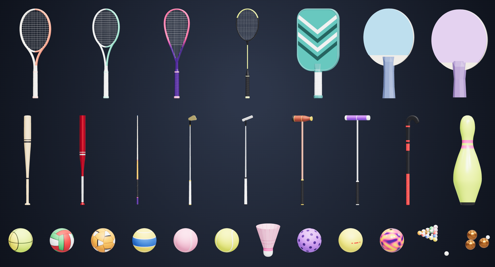
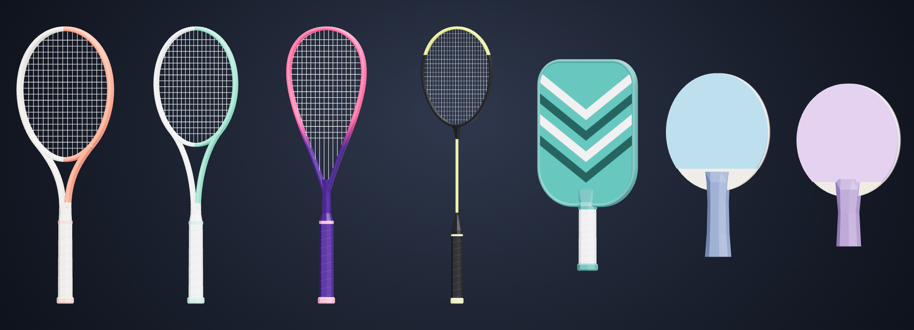
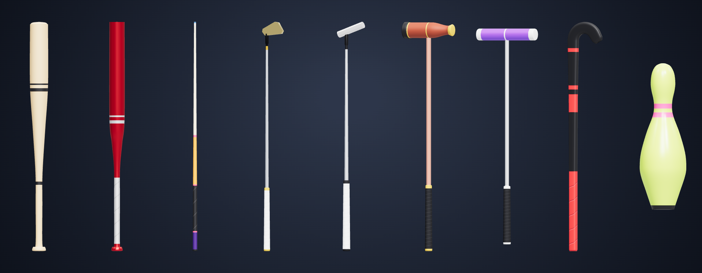
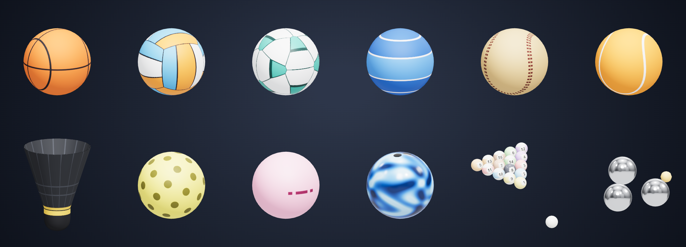

<div align="center">

<h1>sports-gear-generator</h1>

<p><b>28 種類のスポーツ用具をブラウザで生成し、そのまま Blender と Unity へ。</b></p>

<p><i>ラケット、バット、キュー、クラブ、マレット、ボール。全 196 カラーで、GLB または OBJ で書き出せます。</i></p>

<p>
<a href="https://github.com/tipoLi5890/sports-gear-generator/actions/workflows/ci.yml"></a>
<a href="../LICENSE"></a>


</p>

<p><a href="../README.md">English</a> · <a href="README.zh-TW.md">繁體中文</a> · <a href="README.zh-CN.md">简体中文</a> · <b>日本語</b></p>



</div>

1. **すべてプロシージャル。** メッシュとテクスチャはすべてコードで生成。外部のモデルファイルや画像ファイルはありません。
2. **各モデル 7 カラー。** 28 モデル × 7 配色、3 段階の詳細度。ラケットとバットは形状を調整できます。
3. **そのままエンジンへ。** GLB（テクスチャ埋め込み）と OBJ + MTL + PNG を書き出し。単位はメートル、Y 軸が上。

## 使ってみる

**https://tipoLi5890.github.io/sports-gear-generator/** を開くか、clone して `index.html` をブラウザで開いてください。ビルドもサーバーも不要です。

## モデル一覧





| 分類 | モデル | id | メッシュ | 三角形数（低／中／高） | 形状調整 |
|---|---|---|---|---|---|
| ラケット類 | テニスラケット | `tennis` | Frame、Grip、ButtCap、Strings | 1,224 / 2,846 / 8,464 | 面の幅・面の長さ・フレームの厚さ・面の形 |
| ラケット類 | ソフトテニスラケット | `softtennis` | Frame、Grip、ButtCap、Strings | 1,208 / 2,826 / 8,432 | 面の幅・面の長さ・フレームの厚さ |
| ラケット類 | スカッシュラケット | `squash` | Frame、Grip、ButtCap、Strings | 928 / 2,016 / 5,792 | 面の幅・フレームの厚さ |
| ラケット類 | バドミントンラケット | `badminton` | Frame、Grip、ButtCap、Strings | 1,064 / 2,182 / 5,782 | 面の幅・面の長さ・フレームの厚さ・面の形 |
| ラケット類 | ピックルボールパドル | `pickleball` | Face、EdgeGuard、Grip、ButtCap | 1,016 / 2,648 / 8,216 | 面の幅・面の長さ・角の丸み・面の厚さ |
| ラケット類 | 卓球ラケット（シェーク） | `tt_shake` | Blade、RubberFront、RubberBack、Handle | 472 / 856 / 1,640 | — |
| ラケット類 | 卓球ラケット（ペン） | `tt_pen` | Blade、RubberFront、RubberBack、Handle | 472 / 872 / 1,688 | — |
| バット・クラブ類 | 野球バット | `bat` | Bat | 552 / 1,880 / 4,544 | 長さ・バット先端の直径 |
| バット・クラブ類 | ソフトボールバット | `softball_bat` | Bat | 552 / 1,880 / 4,544 | 長さ・バット先端の直径 |
| バット・クラブ類 | ビリヤードキュー | `cue` | Cue | 192 / 320 / 512 | — |
| バット・クラブ類 | ゴルフアイアン | `golf_iron` | Grip、Shaft、Head | 200 / 312 / 480 | — |
| バット・クラブ類 | パター | `golf_putter` | Grip、Shaft、Head | 200 / 312 / 480 | — |
| バット・クラブ類 | ウッドボールのマレット | `woodball` | Grip、Shaft、Head | 348 / 1,460 / 2,336 | — |
| バット・クラブ類 | ゲートボールのスティック | `gateball` | Grip、Shaft、Head | 204 / 340 / 544 | — |
| バット・クラブ類 | フィールドホッケースティック | `hockey` | Stick | 240 / 552 / 1,560 | — |
| バット・クラブ類 | ボウリングピン | `bowling_pin` | Pin | 360 / 1,240 / 4,032 | — |
| ボール類 | バスケットボール | `basketball` | Ball | 360 / 960 / 2,600 | — |
| ボール類 | バレーボール | `volleyball` | Ball | 360 / 960 / 2,600 | — |
| ボール類 | サッカーボール | `soccer` | Ball | 360 / 960 / 2,600 | — |
| ボール類 | ドッジボール | `dodgeball` | Ball | 360 / 960 / 2,600 | — |
| ボール類 | 野球ボール | `baseball` | Ball | 360 / 960 / 2,600 | — |
| ボール類 | テニスボール | `tennis_ball` | Ball | 360 / 960 / 2,600 | — |
| ボール類 | シャトル | `shuttlecock` | Cork、Skirt | 192 / 800 / 1,280 | — |
| ボール類 | ピックルボール | `pickleball_ball` | Ball | 360 / 960 / 2,600 | — |
| ボール類 | 卓球ボール | `tt_ball` | Ball | 360 / 960 / 2,600 | — |
| ボール類 | ボウリングボール | `bowling_ball` | Ball | 360 / 960 / 2,600 | — |
| ボール類 | ビリヤードボール（16 個） | `pool_balls` | CueBall、Ball1 … Ball15 | 2,688 / 8,448 / 21,888 | — |
| ボール類 | ペタンク | `petanque` | Boules、Jack | 792 / 2,304 / 5,664 | — |

各モデルに 7 つのカラーがあり、id は `<モデル>_<名前>` の形式です（例：`racket_serve_pao`、`badminton_aurora`、`pool_balls_classic`）。書き出すファイル名にもこの id を使います。

## 書き出しと読み込み

ページの UI は繁体字中国語です。書き出し欄には 4 つのボタンがあり、どれも現在の形状と詳細度で書き出します。

| ボタン（ページ上の表記） | 得られるもの |
|---|---|
| 目前樣式 GLB | テクスチャ埋め込みの `.glb` 1 つ |
| 目前樣式 OBJ（ZIP） | `.obj`、`.mtl`、マテリアルごとの `.png` が入ったフォルダ |
| 下載「<モデル名>」全部 7 款（ZIP） | カラーごとに `<モデル>/glb/` と `<モデル>/obj/`、`README.txt` 付き |
| 下載全部 28 種共 196 款（ZIP） | 全 196 カラー・両形式、約 21 MB、30 秒ほど |

| 形式 | Blender | Unity |
|---|---|---|
| `.glb`（テクスチャ埋め込み） | ファイル → インポート → glTF 2.0 | glTFast パッケージ（`com.unity.cloud.gltfast`）を入れてから Assets にドラッグ |
| `.obj` + `.mtl` + `.png` | ファイル → インポート → Wavefront (.obj) | フォルダごと Assets にドラッグ（テクスチャのリンクが保たれます） |

座標の約束：

- 単位はメートル、Y 軸が上。
- ラケット、バット、キュー、クラブ、マレット、スティックは原点がグリップの端で、+Y がヘッド側。
- 単体のボールは原点が中心。ボールのセットとボウリングピンは地面（`y = 0`）に置かれています。

Blender 5.2（glTF 読み込み）、Unity 6000.3（OBJ 読み込み）、Khronos glTF Validator（GLB 196 個すべてエラー・警告なし）で確認済みです。

## 仕組み

`src/core.js` は three.js に依存しない素の JavaScript です。4 つの基本手法でインデックス付き三角形メッシュを作ります：2D パスに沿った断面のスイープ（フレーム、グリップ、ストリング）、回転体（バット、キュー、ピン、ボール）、輪郭の押し出し（パドル面、クラブヘッド）、UV 球。テクスチャは実行時に 2D canvas に描きます。色帯、正面投影の塗装、球面の方向から 1 ピクセルずつ計算するボール模様の 3 種類です。`src/app.js` がこのデータを three.js のメッシュにしてプレビューし、書き出しを担当します。

## 制限事項

- ボール表面の細部はテクスチャのみです。バスケットボールの溝、バレーボールとサッカーボールのパネル、野球ボールの縫い目、ピックルボールの穴、ボウリングボールの指穴は描いたもので、立体ではありません。
- ゴルフアイアンのヘッドは簡略化したブレード形状で、キャビティやフェースの溝はありません。
- スカッシュとバドミントンのストリングは直線で、扇状の配置や編み込みはありません。
- すべてのカラーはオリジナルで、特定ブランドのデザインを再現したものではありません。

## 開発

```sh
npm run check   # すべてのモデルとカラーのジオメトリ検査
npm run build   # src/ を index.html に埋め込む
npm run media   # README の画像を作り直す（npm install と Chrome が必要）
```

編集するのは `src/core.js`、`src/app.js`、`src/template.html` で、`index.html` は直接編集しないでください。モデルを追加するときは `src/core.js` に形状関数とマテリアル関数を足し、`SPORTS` に 1 項目加えます。`npm run check` が通る必要があります。[CONTRIBUTING](CONTRIBUTING.md) と、構成を説明した `CLAUDE.md` を参照してください。

## ライセンス

MIT。[LICENSE](../LICENSE) を参照してください。

---

<p align="center"><sub><b>Claude Fable 5.2</b> で制作しました。</sub></p>
