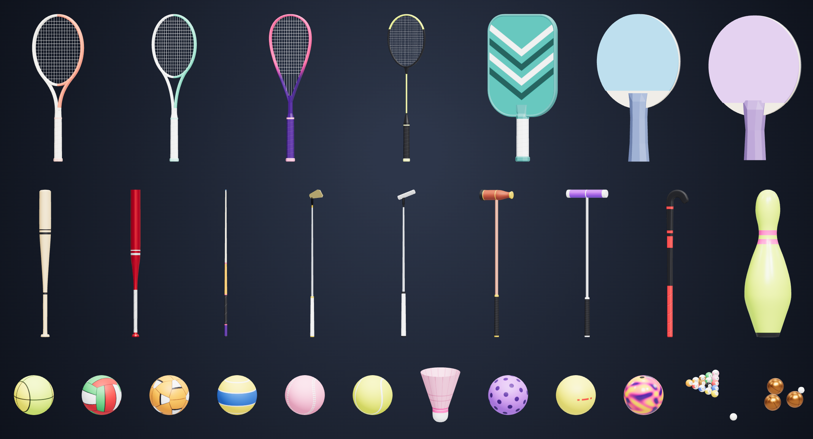
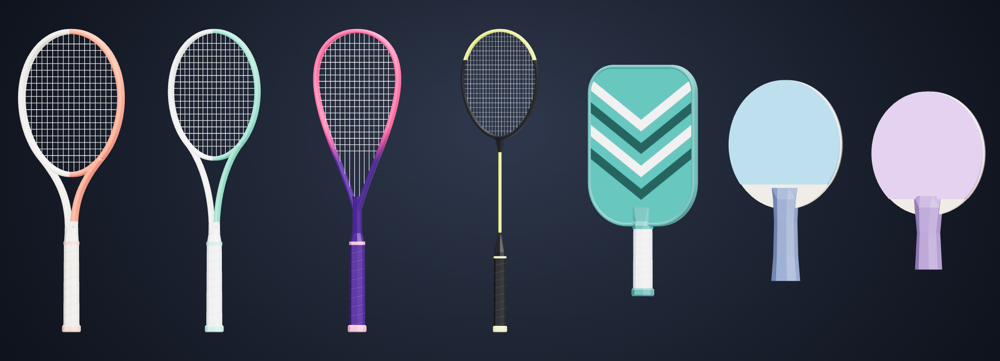
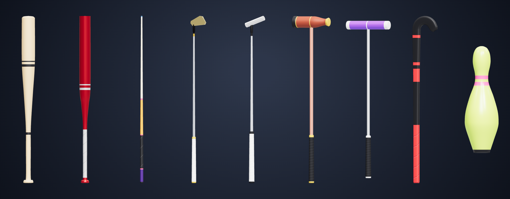
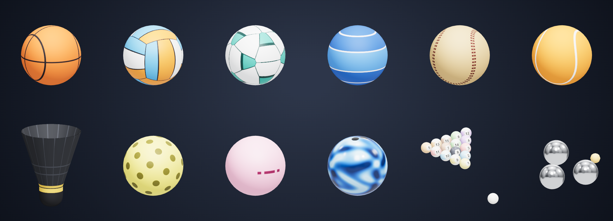

<div align="center">

<h1>sports-gear-generator</h1>

<p><b>在浏览器里生成 28 种球具，直接导出到 Blender 与 Unity。</b></p>

<p><i>球拍、球棒、球杆、槌与球，共 196 款涂装，导出 GLB 或 OBJ。</i></p>

<p>
<a href="https://github.com/tipoLi5890/sports-gear-generator/actions/workflows/ci.yml"></a>
<a href="../LICENSE"></a>


</p>

<p><a href="../README.md">English</a> · <a href="README.zh-TW.md">繁體中文</a> · <b>简体中文</b> · <a href="README.ja.md">日本語</a></p>



</div>

1. **完全程序化。** 所有网格与贴图都由代码生成，没有外部模型文件或图片文件。
2. **每种七款涂装。** 28 种模型 × 7 款配色，三级精细度，球拍与球棒可调外形。
3. **可直接进引擎。** 导出 GLB（贴图内嵌）与 OBJ + MTL + PNG，单位米、Y 轴朝上。

## 试用

打开 **https://tipoLi5890.github.io/sports-gear-generator/**，或 clone 后直接用浏览器打开 `index.html`。使用时不需要构建，也不需要服务器。

## 模型一览





| 类别 | 模型 | id | 网格对象 | 三角面（低／中／高） | 可调外形 |
|---|---|---|---|---|---|
| 拍类 | 网球拍 | `tennis` | Frame、Grip、ButtCap、Strings | 1,224 / 2,846 / 8,464 | 拍面宽度、拍面长度、拍框厚度、拍面形状 |
| 拍类 | 软式网球拍 | `softtennis` | Frame、Grip、ButtCap、Strings | 1,208 / 2,826 / 8,432 | 拍面宽度、拍面长度、拍框厚度 |
| 拍类 | 壁球拍 | `squash` | Frame、Grip、ButtCap、Strings | 928 / 2,016 / 5,792 | 拍面宽度、拍框厚度 |
| 拍类 | 羽毛球拍 | `badminton` | Frame、Grip、ButtCap、Strings | 1,064 / 2,182 / 5,782 | 拍面宽度、拍面长度、拍框厚度、拍面形状 |
| 拍类 | 匹克球拍 | `pickleball` | Face、EdgeGuard、Grip、ButtCap | 1,016 / 2,648 / 8,216 | 拍面宽度、拍面长度、圆角、拍面厚度 |
| 拍类 | 乒乓球拍（横拍） | `tt_shake` | Blade、RubberFront、RubberBack、Handle | 472 / 856 / 1,640 | — |
| 拍类 | 乒乓球拍（直拍） | `tt_pen` | Blade、RubberFront、RubberBack、Handle | 472 / 872 / 1,688 | — |
| 棒杆类 | 棒球棒 | `bat` | Bat | 552 / 1,880 / 4,544 | 长度、棒头直径 |
| 棒杆类 | 垒球棒 | `softball_bat` | Bat | 552 / 1,880 / 4,544 | 长度、棒头直径 |
| 棒杆类 | 台球杆 | `cue` | Cue | 192 / 320 / 512 | — |
| 棒杆类 | 高尔夫铁杆 | `golf_iron` | Grip、Shaft、Head | 200 / 312 / 480 | — |
| 棒杆类 | 高尔夫推杆 | `golf_putter` | Grip、Shaft、Head | 200 / 312 / 480 | — |
| 棒杆类 | 木球杆 | `woodball` | Grip、Shaft、Head | 348 / 1,460 / 2,336 | — |
| 棒杆类 | 门球杆 | `gateball` | Grip、Shaft、Head | 204 / 340 / 544 | — |
| 棒杆类 | 曲棍球棍 | `hockey` | Stick | 240 / 552 / 1,560 | — |
| 棒杆类 | 保龄球瓶 | `bowling_pin` | Pin | 360 / 1,240 / 4,032 | — |
| 球类 | 篮球 | `basketball` | Ball | 360 / 960 / 2,600 | — |
| 球类 | 排球 | `volleyball` | Ball | 360 / 960 / 2,600 | — |
| 球类 | 足球 | `soccer` | Ball | 360 / 960 / 2,600 | — |
| 球类 | 躲避球 | `dodgeball` | Ball | 360 / 960 / 2,600 | — |
| 球类 | 棒球 | `baseball` | Ball | 360 / 960 / 2,600 | — |
| 球类 | 网球 | `tennis_ball` | Ball | 360 / 960 / 2,600 | — |
| 球类 | 羽毛球 | `shuttlecock` | Cork、Skirt | 192 / 800 / 1,280 | — |
| 球类 | 匹克球 | `pickleball_ball` | Ball | 360 / 960 / 2,600 | — |
| 球类 | 乒乓球 | `tt_ball` | Ball | 360 / 960 / 2,600 | — |
| 球类 | 保龄球 | `bowling_ball` | Ball | 360 / 960 / 2,600 | — |
| 球类 | 台球（16 颗） | `pool_balls` | CueBall、Ball1 … Ball15 | 2,688 / 8,448 / 21,888 | — |
| 球类 | 法式滚球 | `petanque` | Boules、Jack | 792 / 2,304 / 5,664 | — |

每种模型都有七款涂装，id 格式是 `<模型>_<名称>`，例如 `racket_serve_pao`、`badminton_aurora`、`pool_balls_classic`，导出的文件名也用这个 id。

## 导出与导入

导出区有四个按钮，都会套用当前的外形与精细度。

| 按钮 | 得到的文件 |
|---|---|
| 目前样式 GLB | 一个贴图内嵌的 `.glb` |
| 目前样式 OBJ（ZIP） | 一个文件夹，内含 `.obj`、`.mtl`，每个材质一张 `.png` |
| 下载「<模型名称>」全部 7 款（ZIP） | 每款各有 `<模型>/glb/` 与 `<模型>/obj/`，附 `README.txt` |
| 下载全部 28 种共 196 款（ZIP） | 196 款、两种格式，约 21 MB，大约 30 秒 |

页面界面是繁体中文，上表按钮名称为对应的简体写法。

| 格式 | Blender | Unity |
|---|---|---|
| `.glb`（贴图内嵌） | 文件 → 导入 → glTF 2.0 | 先安装 glTFast 包（`com.unity.cloud.gltfast`），再把文件拖进 Assets |
| `.obj` + `.mtl` + `.png` | 文件 → 导入 → Wavefront (.obj) | 整个文件夹拖进 Assets，贴图才会关联上 |

坐标约定：

- 单位是米，Y 轴朝上。
- 球拍、球棒、球杆、槌、球棍的原点在握把底部，+Y 朝前端。
- 单颗球的原点在球心；成组的球与保龄球瓶放在地面（`y = 0`）上。

已用 Blender 5.2（导入 glTF）、Unity 6000.3（导入 OBJ）与 Khronos glTF Validator（196 个 GLB 全部无错误、无警告）验证。

## 工作原理

`src/core.js` 是纯 JavaScript，不依赖 three.js。它用四种基本方法生成索引三角网格：沿 2D 路径扫掠截面（拍框、握把、球线）、旋转体（球棒、球杆、球瓶、球）、轮廓挤出（拍面、杆头）以及 UV 球。贴图在运行时画在 2D canvas 上，分为色带、正面投影的涂装图，以及按球面方向逐像素计算的球纹。`src/app.js` 把这些数据转成 three.js 网格做预览，并负责导出。

## 已知限制

- 球面细节只有贴图。篮球沟线、排球与足球拼片、棒球缝线、匹克球的孔、保龄球指孔都是画上去的，没有立体造型。
- 高尔夫铁杆杆头是简化的刀背造型，没有背面凹槽与杆面沟线。
- 壁球拍与羽毛球拍的球线是直线，没有扇形排列与交织。
- 所有涂装均为原创，不对应任何品牌的设计。

## 开发

```sh
npm run check   # 检查所有模型与涂装的几何
npm run build   # 把 src/ 内嵌进 index.html
npm run media   # 重新生成 README 图片（需要先 npm install 并安装 Chrome）
```

请修改 `src/core.js`、`src/app.js` 或 `src/template.html`，不要直接改 `index.html`。新增模型时，在 `src/core.js` 加一个建模函数与材质函数，并在 `SPORTS` 列表加一项；`npm run check` 必须通过。另见 [CONTRIBUTING](CONTRIBUTING.md)；架构说明见 `CLAUDE.md`。

## 许可证

MIT，见 [LICENSE](../LICENSE)。

---

<p align="center"><sub>使用 <b>Claude Fable 5.2</b> 制作。</sub></p>
