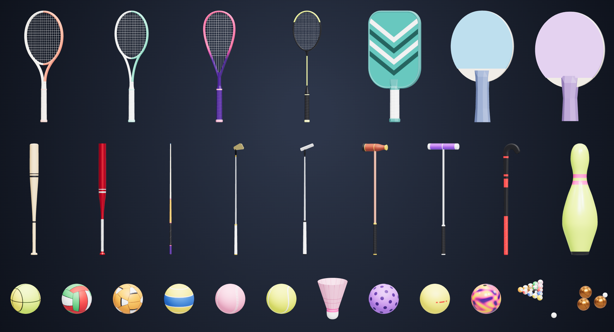
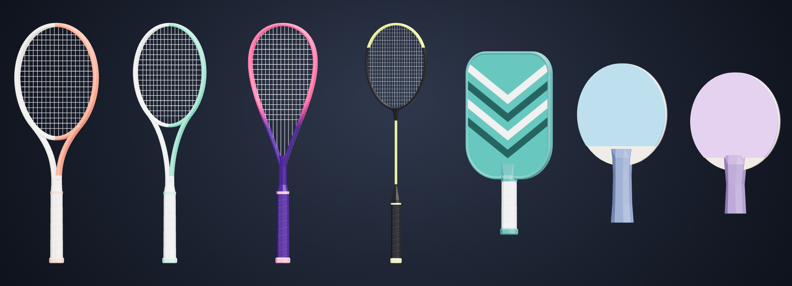
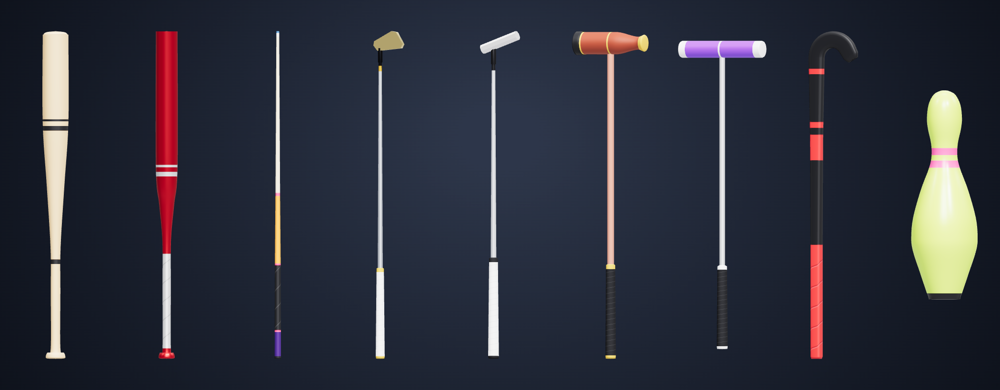
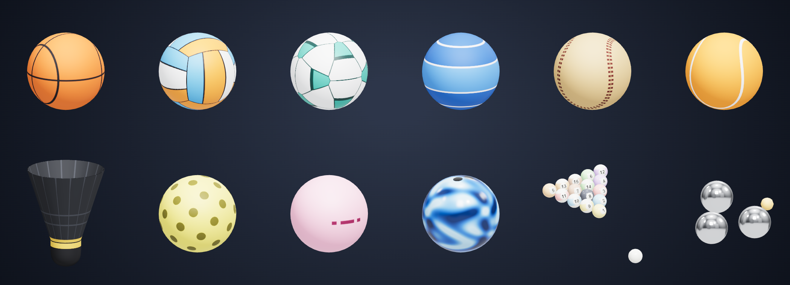

<div align="center">

<h1>sports-gear-generator</h1>

<p><b>在瀏覽器裡產生 28 種球具，直接匯出到 Blender 與 Unity。</b></p>

<p><i>球拍、球棒、球桿、槌與球，共 196 款塗裝，匯出 GLB 或 OBJ。</i></p>

<p>
<a href="https://github.com/tipoLi5890/sports-gear-generator/actions/workflows/ci.yml"></a>
<a href="../LICENSE"></a>


</p>

<p><a href="../README.md">English</a> · <b>繁體中文</b> · <a href="README.zh-CN.md">简体中文</a> · <a href="README.ja.md">日本語</a></p>



</div>

1. **完全程序化。** 所有網格與貼圖都由程式產生，沒有外部模型檔或圖片檔。
2. **每種七款塗裝。** 28 種模型 × 7 款配色，三級精細度，球拍與球棒可調外型。
3. **可直接進引擎。** 匯出 GLB（貼圖內嵌）與 OBJ + MTL + PNG，單位公尺、Y 軸朝上。

## 試用

開啟 **https://tipoLi5890.github.io/sports-gear-generator/**，或 clone 後直接用瀏覽器開 `index.html`。使用時不需要建置，也不需要伺服器。

## 模型一覽





| 類別 | 模型 | id | 網格物件 | 三角面（低／中／高） | 可調外型 |
|---|---|---|---|---|---|
| 拍類 | 網球拍 | `tennis` | Frame、Grip、ButtCap、Strings | 1,224 / 2,846 / 8,464 | 拍面寬度、拍面長度、拍框厚度、拍面形狀 |
| 拍類 | 軟式網球拍 | `softtennis` | Frame、Grip、ButtCap、Strings | 1,208 / 2,826 / 8,432 | 拍面寬度、拍面長度、拍框厚度 |
| 拍類 | 壁球拍 | `squash` | Frame、Grip、ButtCap、Strings | 928 / 2,016 / 5,792 | 拍面寬度、拍框厚度 |
| 拍類 | 羽球拍 | `badminton` | Frame、Grip、ButtCap、Strings | 1,064 / 2,182 / 5,782 | 拍面寬度、拍面長度、拍框厚度、拍面形狀 |
| 拍類 | 匹克球拍 | `pickleball` | Face、EdgeGuard、Grip、ButtCap | 1,016 / 2,648 / 8,216 | 拍面寬度、拍面長度、圓角、拍面厚度 |
| 拍類 | 桌球拍（橫拍） | `tt_shake` | Blade、RubberFront、RubberBack、Handle | 472 / 856 / 1,640 | — |
| 拍類 | 桌球拍（直拍） | `tt_pen` | Blade、RubberFront、RubberBack、Handle | 472 / 872 / 1,688 | — |
| 棒桿類 | 棒球棒 | `bat` | Bat | 552 / 1,880 / 4,544 | 長度、棒頭直徑 |
| 棒桿類 | 壘球棒 | `softball_bat` | Bat | 552 / 1,880 / 4,544 | 長度、棒頭直徑 |
| 棒桿類 | 撞球桿 | `cue` | Cue | 192 / 320 / 512 | — |
| 棒桿類 | 高爾夫鐵桿 | `golf_iron` | Grip、Shaft、Head | 200 / 312 / 480 | — |
| 棒桿類 | 高爾夫推桿 | `golf_putter` | Grip、Shaft、Head | 200 / 312 / 480 | — |
| 棒桿類 | 木球桿 | `woodball` | Grip、Shaft、Head | 348 / 1,460 / 2,336 | — |
| 棒桿類 | 槌球桿 | `gateball` | Grip、Shaft、Head | 204 / 340 / 544 | — |
| 棒桿類 | 曲棍球棍 | `hockey` | Stick | 240 / 552 / 1,560 | — |
| 棒桿類 | 保齡球瓶 | `bowling_pin` | Pin | 360 / 1,240 / 4,032 | — |
| 球類 | 籃球 | `basketball` | Ball | 360 / 960 / 2,600 | — |
| 球類 | 排球 | `volleyball` | Ball | 360 / 960 / 2,600 | — |
| 球類 | 足球 | `soccer` | Ball | 360 / 960 / 2,600 | — |
| 球類 | 躲避球 | `dodgeball` | Ball | 360 / 960 / 2,600 | — |
| 球類 | 棒球 | `baseball` | Ball | 360 / 960 / 2,600 | — |
| 球類 | 網球 | `tennis_ball` | Ball | 360 / 960 / 2,600 | — |
| 球類 | 羽毛球 | `shuttlecock` | Cork、Skirt | 192 / 800 / 1,280 | — |
| 球類 | 匹克球 | `pickleball_ball` | Ball | 360 / 960 / 2,600 | — |
| 球類 | 桌球 | `tt_ball` | Ball | 360 / 960 / 2,600 | — |
| 球類 | 保齡球 | `bowling_ball` | Ball | 360 / 960 / 2,600 | — |
| 球類 | 撞球（16 顆） | `pool_balls` | CueBall、Ball1 … Ball15 | 2,688 / 8,448 / 21,888 | — |
| 球類 | 法式滾球 | `petanque` | Boules、Jack | 792 / 2,304 / 5,664 | — |

每種模型都有七款塗裝，id 格式是 `<模型>_<名稱>`，例如 `racket_serve_pao`、`badminton_aurora`、`pool_balls_classic`，匯出的檔名也用這個 id。

## 匯出與匯入

匯出區有四個按鈕，都會套用目前的外型與精細度。

| 按鈕 | 得到的檔案 |
|---|---|
| 目前樣式 GLB | 一個貼圖內嵌的 `.glb` |
| 目前樣式 OBJ（ZIP） | 一個資料夾，內含 `.obj`、`.mtl`，每個材質一張 `.png` |
| 下載「<模型名稱>」全部 7 款（ZIP） | 每款各有 `<模型>/glb/` 與 `<模型>/obj/`，附 `README.txt` |
| 下載全部 28 種共 196 款（ZIP） | 196 款、兩種格式，約 21 MB，大約 30 秒 |

| 格式 | Blender | Unity |
|---|---|---|
| `.glb`（貼圖內嵌） | 檔案 → 匯入 → glTF 2.0 | 先安裝 glTFast 套件（`com.unity.cloud.gltfast`），再把檔案拖進 Assets |
| `.obj` + `.mtl` + `.png` | 檔案 → 匯入 → Wavefront (.obj) | 整個資料夾拖進 Assets，貼圖才會連上 |

座標慣例：

- 單位是公尺，Y 軸朝上。
- 球拍、球棒、球桿、槌、球棍的原點在握把底部，+Y 朝前端。
- 單顆球的原點在球心；成組的球與保齡球瓶放在地面（`y = 0`）上。

已用 Blender 5.2（匯入 glTF）、Unity 6000.3（匯入 OBJ）與 Khronos glTF Validator（196 個 GLB 全數無錯誤、無警告）驗證。

## 運作方式

`src/core.js` 是純 JavaScript，不依賴 three.js。它用四種基本做法產生索引三角網格：沿 2D 路徑掃掠截面（拍框、握把、弦線）、旋轉體（球棒、球桿、球瓶、球）、輪廓擠出（拍面、桿頭）以及 UV 球。貼圖在執行時畫在 2D canvas 上，分成色帶、正面投影的塗裝圖，以及依球面方向逐像素計算的球紋。`src/app.js` 把這些資料轉成 three.js 網格做預覽，並負責匯出。

## 已知限制

- 球面細節只有貼圖。籃球溝線、排球與足球拼片、棒球縫線、匹克球的洞、保齡球指孔都是畫上去的，沒有立體造型。
- 高爾夫鐵桿桿頭是簡化的刀背造型，沒有背面凹槽與桿面溝線。
- 壁球拍與羽球拍的弦線是直線，沒有扇形排列與交織。
- 所有塗裝皆為原創，不對應任何品牌的設計。

## 開發

```sh
npm run check   # 檢查所有模型與塗裝的幾何
npm run build   # 把 src/ 內嵌進 index.html
npm run media   # 重新產生 README 圖片（需要先 npm install 並安裝 Chrome）
```

請修改 `src/core.js`、`src/app.js` 或 `src/template.html`，不要直接改 `index.html`。新增模型時，在 `src/core.js` 加一個建模函式與材質函式，並在 `SPORTS` 清單加一筆；`npm run check` 必須通過。另見 [CONTRIBUTING](CONTRIBUTING.md)；架構說明見 `CLAUDE.md`。

## 授權

MIT，見 [LICENSE](../LICENSE)。

---

<p align="center"><sub>使用 <b>Claude Fable 5.2</b> 製作。</sub></p>
