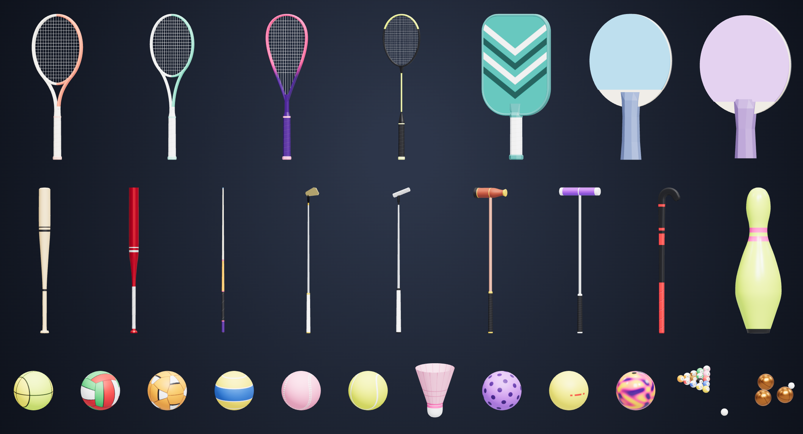
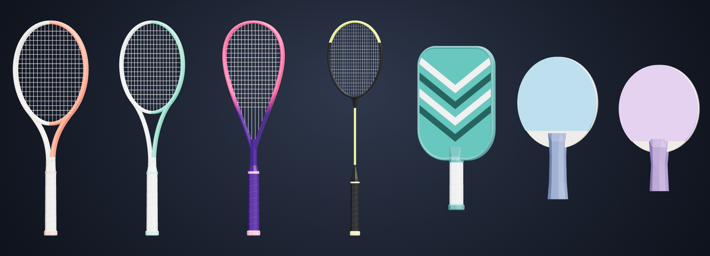
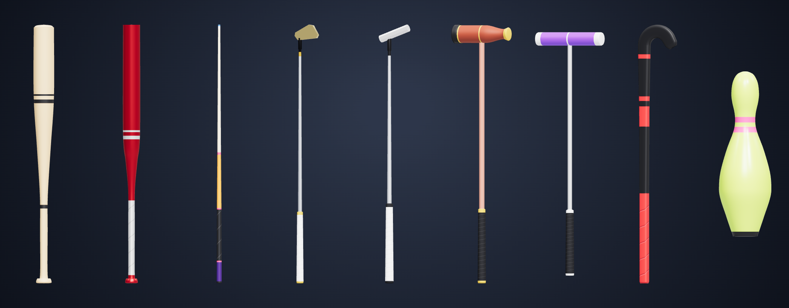
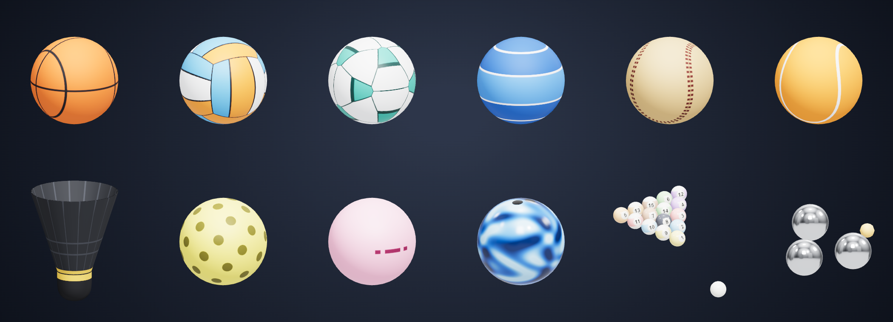

<div align="center">

<h1>sports-gear-generator</h1>

<p><b>28 kinds of sports equipment, generated in the browser and ready for Blender and Unity.</b></p>

<p><i>Rackets, bats, cues, clubs, mallets and balls — 196 colourways, exported as GLB or OBJ.</i></p>

<p>
<a href="https://github.com/tipoLi5890/sports-gear-generator/actions/workflows/ci.yml"></a>
<a href="LICENSE"></a>


</p>

<p><b>English</b> · <a href=".github/README.zh-TW.md">繁體中文</a> · <a href=".github/README.zh-CN.md">简体中文</a> · <a href=".github/README.ja.md">日本語</a></p>



</div>

1. **Fully procedural.** Every mesh and texture is generated in code. There are no external model or image files.
2. **Seven colourways each.** 28 models × 7 paint jobs, three levels of detail, and adjustable dimensions on rackets and bats.
3. **Ready for engines.** Exports GLB (textures embedded) and OBJ + MTL + PNG, in meters, Y-up.

## Try it

Open **https://tipoLi5890.github.io/sports-gear-generator/** or clone the repo and open `index.html` in a browser. No build step or server is needed to use it.

## The models





| Group | Model | id | Mesh parts | Triangles (low / mid / high) | Adjustable |
|---|---|---|---|---|---|
| Rackets & paddles | Tennis racket | `tennis` | Frame, Grip, ButtCap, Strings | 1,224 / 2,846 / 8,464 | yes |
| Rackets & paddles | Soft tennis racket | `softtennis` | Frame, Grip, ButtCap, Strings | 1,208 / 2,826 / 8,432 | yes |
| Rackets & paddles | Squash racket | `squash` | Frame, Grip, ButtCap, Strings | 928 / 2,016 / 5,792 | yes |
| Rackets & paddles | Badminton racket | `badminton` | Frame, Grip, ButtCap, Strings | 1,064 / 2,182 / 5,782 | yes |
| Rackets & paddles | Pickleball paddle | `pickleball` | Face, EdgeGuard, Grip, ButtCap | 1,016 / 2,648 / 8,216 | yes |
| Rackets & paddles | Table tennis bat (shakehand) | `tt_shake` | Blade, RubberFront, RubberBack, Handle | 472 / 856 / 1,640 | — |
| Rackets & paddles | Table tennis bat (penhold) | `tt_pen` | Blade, RubberFront, RubberBack, Handle | 472 / 872 / 1,688 | — |
| Bats, cues, clubs & sticks | Baseball bat | `bat` | Bat | 552 / 1,880 / 4,544 | yes |
| Bats, cues, clubs & sticks | Softball bat | `softball_bat` | Bat | 552 / 1,880 / 4,544 | yes |
| Bats, cues, clubs & sticks | Pool cue | `cue` | Cue | 192 / 320 / 512 | — |
| Bats, cues, clubs & sticks | Golf iron | `golf_iron` | Grip, Shaft, Head | 200 / 312 / 480 | — |
| Bats, cues, clubs & sticks | Golf putter | `golf_putter` | Grip, Shaft, Head | 200 / 312 / 480 | — |
| Bats, cues, clubs & sticks | Woodball mallet | `woodball` | Grip, Shaft, Head | 348 / 1,460 / 2,336 | — |
| Bats, cues, clubs & sticks | Gateball mallet | `gateball` | Grip, Shaft, Head | 204 / 340 / 544 | — |
| Bats, cues, clubs & sticks | Field hockey stick | `hockey` | Stick | 240 / 552 / 1,560 | — |
| Bats, cues, clubs & sticks | Bowling pin | `bowling_pin` | Pin | 360 / 1,240 / 4,032 | — |
| Balls | Basketball | `basketball` | Ball | 360 / 960 / 2,600 | — |
| Balls | Volleyball | `volleyball` | Ball | 360 / 960 / 2,600 | — |
| Balls | Football (soccer) | `soccer` | Ball | 360 / 960 / 2,600 | — |
| Balls | Dodgeball | `dodgeball` | Ball | 360 / 960 / 2,600 | — |
| Balls | Baseball | `baseball` | Ball | 360 / 960 / 2,600 | — |
| Balls | Tennis ball | `tennis_ball` | Ball | 360 / 960 / 2,600 | — |
| Balls | Shuttlecock | `shuttlecock` | Cork, Skirt | 192 / 800 / 1,280 | — |
| Balls | Pickleball | `pickleball_ball` | Ball | 360 / 960 / 2,600 | — |
| Balls | Table tennis ball | `tt_ball` | Ball | 360 / 960 / 2,600 | — |
| Balls | Bowling ball | `bowling_ball` | Ball | 360 / 960 / 2,600 | — |
| Balls | Pool ball set (16) | `pool_balls` | CueBall, Ball1 … Ball15 | 2,688 / 8,448 / 21,888 | — |
| Balls | Pétanque set (3 boules + jack) | `petanque` | Boules, Jack | 792 / 2,304 / 5,664 | — |

Each model has seven colourways. Their ids follow `<model>_<name>`, for example `racket_serve_pao`, `badminton_aurora` or `pool_balls_classic`, and are used as the exported file names.

## Export and import

The export panel has four buttons. All of them use the current dimensions and level of detail.

| Button | You get |
|---|---|
| Current style · GLB | One `.glb` with embedded textures |
| Current style · OBJ (ZIP) | A folder with `.obj`, `.mtl` and one `.png` per material |
| All 7 styles of this model (ZIP) | `<model>/glb/` and `<model>/obj/` for each colourway, plus a `README.txt` |
| Everything (ZIP) | All 196 colourways in both formats, about 21 MB, around 30 seconds |

| Format | Blender | Unity |
|---|---|---|
| `.glb` (textures embedded) | File → Import → glTF 2.0 | Install the glTFast package (`com.unity.cloud.gltfast`), then drop the file into Assets |
| `.obj` + `.mtl` + `.png` | File → Import → Wavefront (.obj) | Drag the whole folder into Assets so the textures stay linked |

Conventions:

- Units are meters, Y is up.
- Rackets, bats, cues, clubs, mallets and sticks have their origin at the grip end, with +Y pointing towards the head.
- Single balls have their origin at the centre. Ball sets and the bowling pin rest on the ground plane (`y = 0`).

Checked with Blender 5.2 (glTF import), Unity 6000.3 (OBJ import) and the Khronos glTF Validator (all 196 GLB files, no errors or warnings).

## How it works

`src/core.js` is plain JavaScript with no dependency on three.js. It builds indexed triangle meshes from four primitives: a cross-section swept along a 2D path (frames, handles, strings), a surface of revolution (bats, cues, pins, balls), an extruded outline (paddle faces, club heads) and a UV sphere. Textures are drawn at run time on 2D canvases, either as colour bands, front-projected paint maps, or per-pixel functions of the surface direction for ball patterns. `src/app.js` turns that data into three.js meshes for the preview and handles export.

## Limitations

- Ball surface detail is texture only. Basketball channels, volleyball and football panels, baseball stitches, pickleball holes and bowling-ball finger holes are painted, not modelled.
- The golf iron head is a simplified blade without a cavity back or face grooves.
- Squash and badminton strings are straight; they do not fan or weave.
- All colourways are original and do not reproduce any brand's design.

## Working on this repo

```sh
npm run check   # geometry checks for every model and colourway
npm run build   # inline src/ into index.html
npm run media   # re-render the README images (needs npm install and Chrome)
```

Edit `src/core.js`, `src/app.js` or `src/template.html`, never `index.html` directly. To add a model, add a builder and a material function in `src/core.js` and one entry in the `SPORTS` list; `npm run check` must still pass. See [CONTRIBUTING](.github/CONTRIBUTING.md) and `CLAUDE.md` for the architecture.

## Licence

MIT. See [LICENSE](LICENSE).

---

<p align="center"><sub>Made with <b>Claude Fable 5.2</b>.</sub></p>
